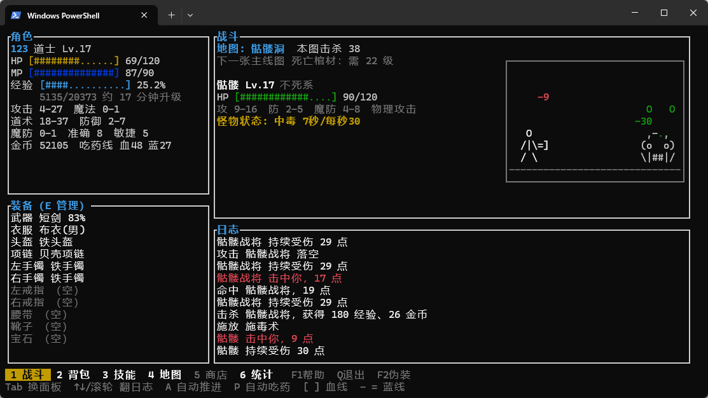
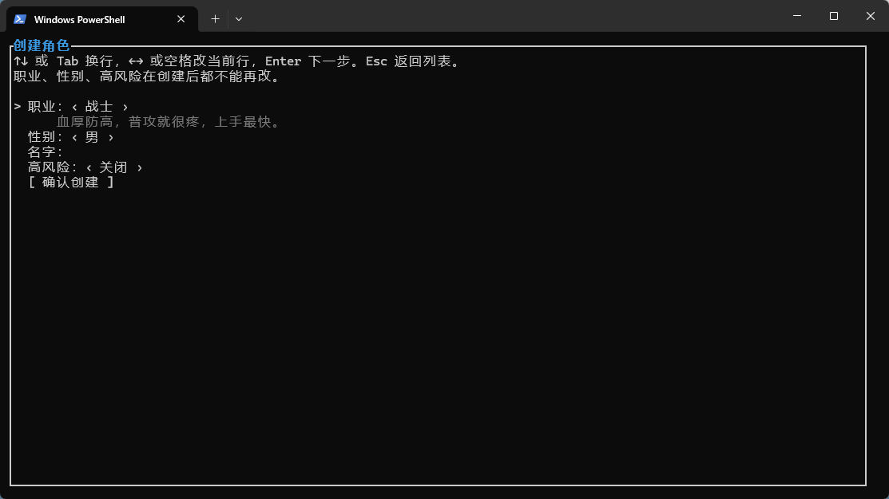
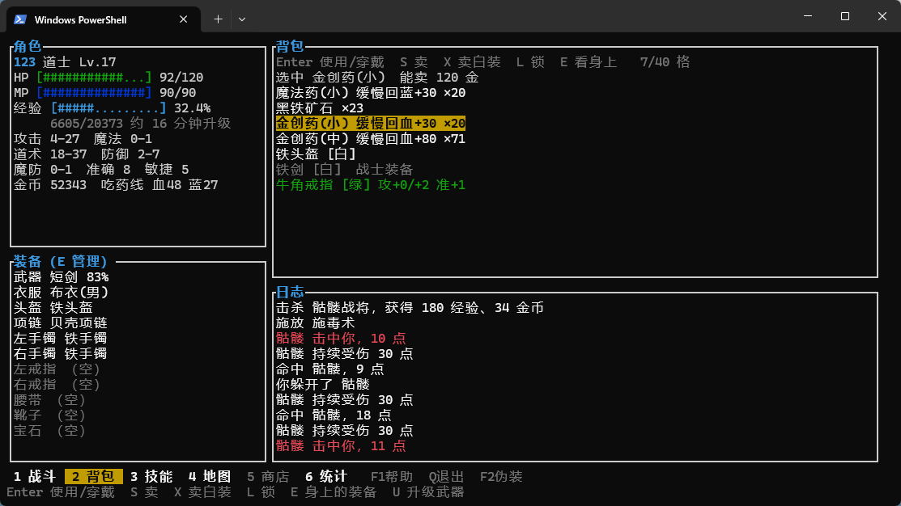
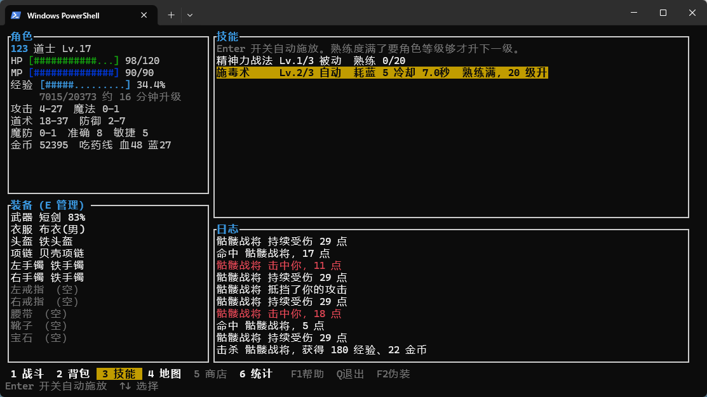
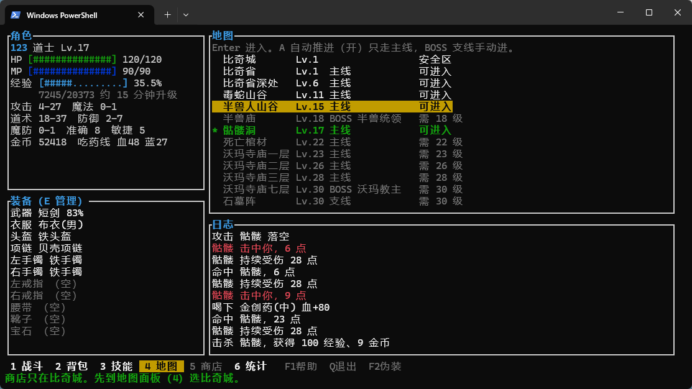
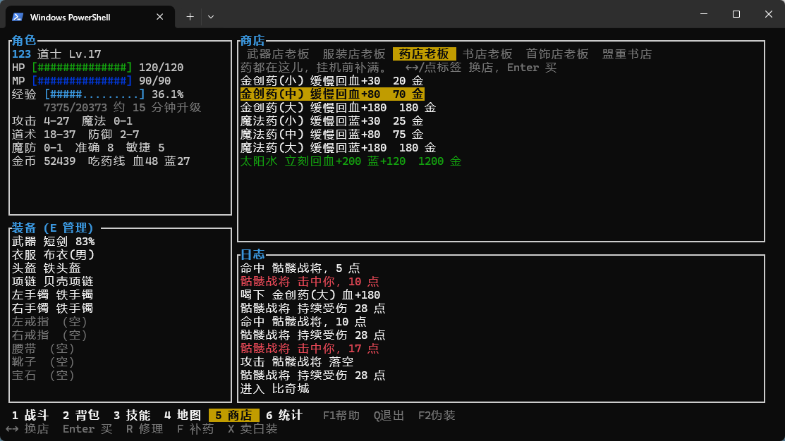
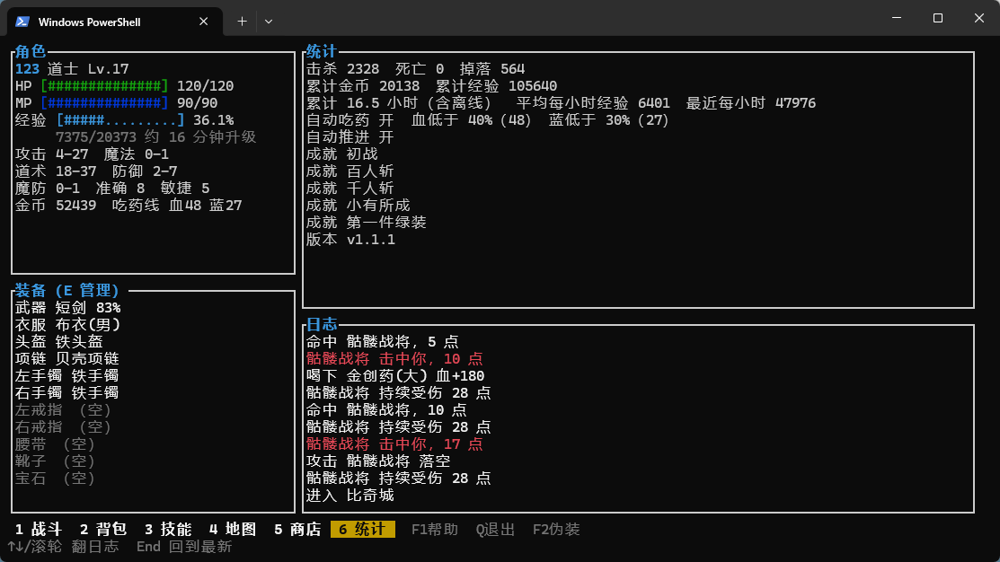
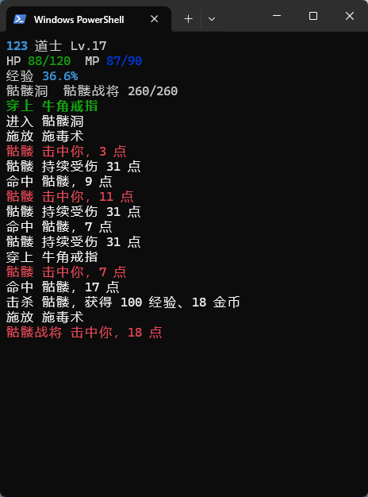

# 游戏简介 —— 热血传奇 TUI 挂机（r-chuanqi）

> 一个跑在终端里的挂机 / 增量（idle）游戏。世界观、怪物、地图、装备、技能取材于**热血传奇 1.67**（顶级内容赤月 / 牛魔取自 1.76），玩法骨架是「挂机打怪 → 升级换装 → 解锁更深地图」的增量循环。
>
> 全部界面由终端字符绘制，支持中文对齐、真彩色、鼠标操作。开一个窗口挂一整天，回来收菜。

## 截图

> 截图统一放在仓库 `screenshots/` 目录下（没有就新建一个），文件名按下表命名，放进正文对应位置即可。

| 文件 | 内容 |
| --- | --- |
| `screenshots/01-main.png` | 战斗主界面（挂机进行中） |
| `screenshots/02-inventory.png` | 背包与装备对比 |
| `screenshots/03-skills.png` | 技能面板 |
| `screenshots/04-maps.png` | 地图与自动推进 |
| `screenshots/05-shop.png` | 商店 |
| `screenshots/06-stats.png` | 统计面板 |
| `screenshots/07-create.png` | 创建角色（职业 / 性别 / 高风险） |
| `screenshots/08-compact.png` | 小窗口挂机模式 |

---

## 这是什么

传奇本身就有很强的挂机属性（当年挂机刷沃玛就是主流玩法），r-chuanqi 把它做成了一款正经的挂机游戏：

- **保留传奇的战斗数值感**：攻击 / 防御都是区间随机，防御能完全吃掉伤害（"抵挡"），命中靠准确对敏捷
- **补上增量游戏的节奏**：清晰的解锁阶梯、永久成长、离线收益、"再玩五分钟"的钩子
- **数值全部外置**：怪物、物品、技能、地图、平衡系数都在 `data/*.ron` 里，改数据不用改代码



*战斗主界面：角色状态、战斗日志、当前地图战况一屏可见。*

## 玩法循环

```
挂机打怪 → 经验 + 金币 + 装备掉落
   ↓             ↓            ↓
  升级        买药 / 修装备   换装 / 强化
   ↓             ↓            ↓
   └──→ 解锁更深地图 → 更强的怪 → 更好的掉落 ─┘
```

四条成长线并行：**等级**（经验曲线软上限）、**装备**（掉落 + 武器升级，硬上限屠龙 / 圣战 / 法神 / 天尊）、**技能**（技能书 + 熟练度，各 3 级）、**地图解锁**（等级 + 前置地图通关）。

## 三职业

| 职业 | 核心属性 | 挂机特点 |
| --- | --- | --- |
| **战士** | 攻击（DC）、准确 | 高血高防，靠金创药续航；烈火剑法蓄力爆发 |
| **法师** | 魔法（MC） | 伤害最高但 MP 是瓶颈、身板脆；群伤在多怪地图收益高 |
| **道士** | 道术（SC） | 续航最强，召唤骷髅 / 神兽分摊伤害，施毒持续掉血 |

职业、性别、高风险模式在**创建角色时选定，之后不能改**。同职业可以开多个角色（比如两个战士），进度完全独立。

<!-- 截图：07-create.png -->


*创建角色：职业、性别、高风险模式。高风险掉落 +50%，但死亡会掉一件没锁定的装备。*

## 核心系统

### 挂机与自动化

- **自动喝药**：血 / 蓝低于阈值自动喝，取能回满的最小规格不浪费；没药且血量危险就自动回城，休息完自己回到原来的图
- **自动推进**（4 级解锁）：只沿地图树的主线走，BOSS 支线（半兽庙、沃玛七层、石墓阵→尸王殿）留给你手动挑战。同级连死 3 次自动退回上一张图，升级后再试
- **自动施法**：满血不加血、盾还在不重开、毒没完不重上、怪快死了不上降防；蓝多挑最猛的，蓝少挑最省的

### 掉落与保底

每只怪一张掉落表，每项独立 roll —— 一只怪可能同时掉好几样。稀有掉落（掉率 < 1%）有保底计数器，杀够期望次数的 3 倍必掉，且日志里不标注，惊喜感不打折。

### 武器升级

传奇特色的赌博式强化：黑铁矿 + 首饰 + 金币 → 成功率随次数递减 → 成功加属性，**失败武器碎裂**。幸运符可以保底（失败时消耗幸运符保住武器），靠挂机掉落获取。UI 会先显示成功率和消耗，二次确认才执行。

### 离线收益

关掉游戏也在涨。离线就是快放同一套 100ms 逻辑 tick，最多累计 12 小时，进游戏弹离线报告。未载入的角色不推进时间（不然等于多开挂机）。

## 界面一览

<!-- 截图：02-inventory.png -->


*背包 / 装备：候选装备和身上的做属性对比，红绿标出增减。E 切到身上的装备，L 锁定。*

<!-- 截图：03-skills.png -->


*技能面板：已学技能、等级、熟练度、自动释放开关。*

<!-- 截图：04-maps.png -->


*地图面板：地图树、解锁条件、当前进度、自动推进开关。*

<!-- 截图：05-shop.png -->


*商店：买药、买书、卖白装（X）、修理（R）、一键补满红蓝（F）。*

<!-- 截图：06-stats.png -->


*统计面板：总击杀、各怪击杀数、总掉落、在线时长、日志回看。*

<!-- 截图：08-compact.png -->


*窗口小于 80×24 时切换到精简挂机视图，按键照常生效，放大自动恢复。*

## 上手

**系统需求**：Windows Terminal（或其它支持 Unicode + 真彩色的终端），窗口至少 80×24 才有完整界面。

```bash
cargo run -p r-chuanqi
```

或下载发布包 `r-chuanqi-setup` 双击安装（Windows 装到 `%LOCALAPPDATA%\Programs\r-chuanqi` 并写入 PATH，其它系统装到 `~/.local/share/tui-game`），新开终端运行 `r-chuanqi`。卸载：`r-chuanqi uninstall`，存档会留下。

常用快捷键：`1`–`6` 切面板，`A` 自动推进，`P` 自动吃药，`U` 武器升级，`Q` 保存退出，`?` 帮助，`F2` 伪装成时钟（摸鱼用），`F3` 更新版本。完整键位见 [README](README.md#操作)。

存档默认在 `%APPDATA%\tui-mir\`，每个角色一个槽位目录，同名可并存。

## 设计文档

玩法公式、掉落规则、任务规划等实现细节在 [doc/](doc/README.md)：

- [玩法设计](doc/03-game-design.md)：战斗公式、掉落、挂机自动化、经验曲线
- [任务规划](doc/05-roadmap.md)：按阶段的执行清单与验收标准
- [设计决策](doc/decisions.md)：ADR-001 … ADR-007 拍板记录
